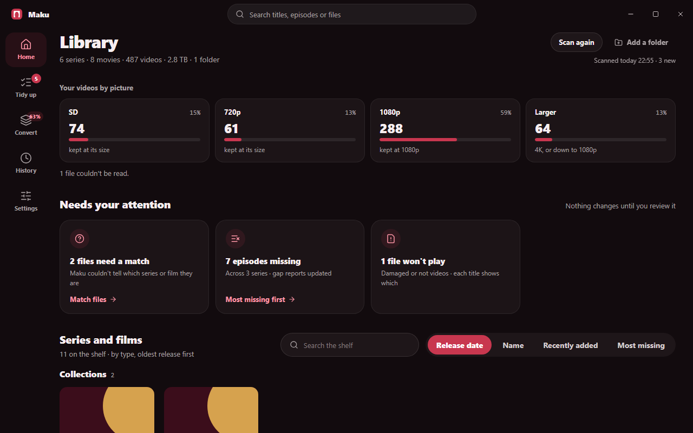
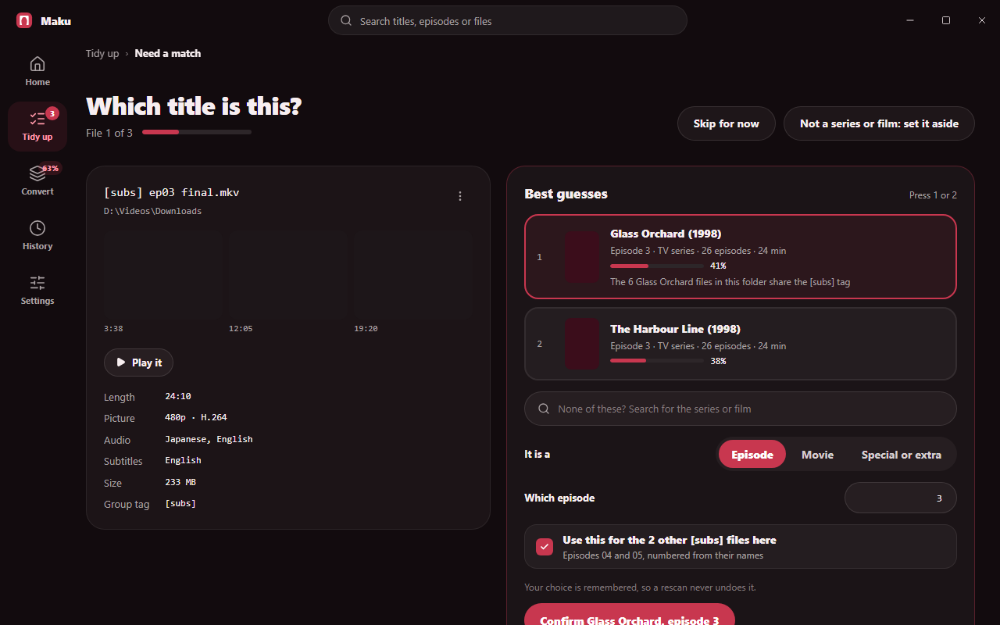
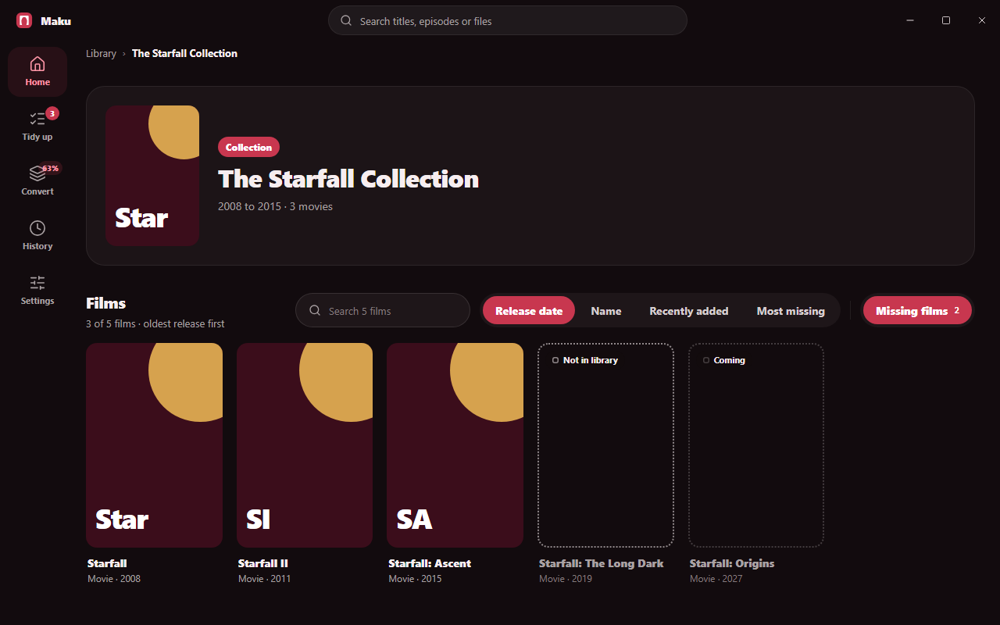
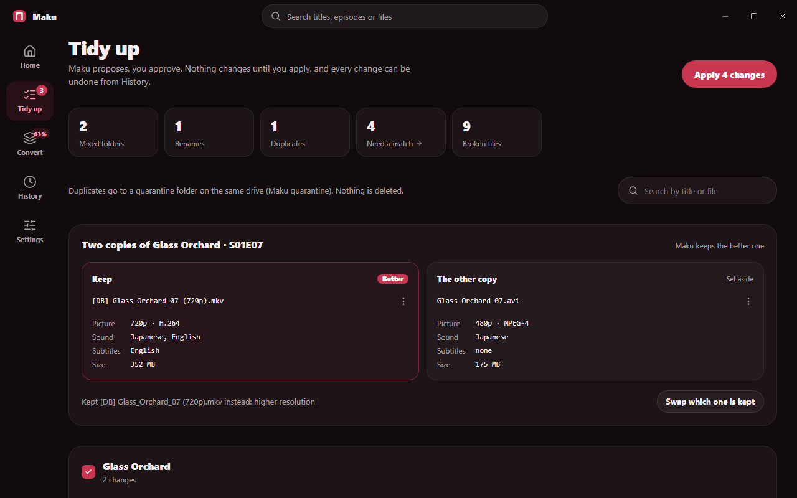
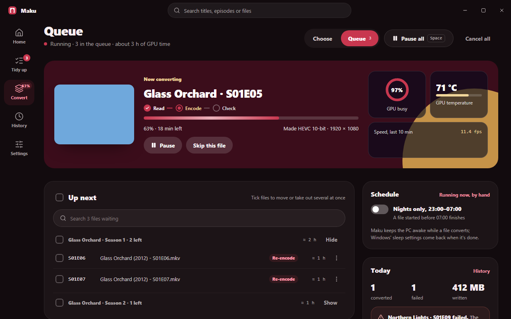
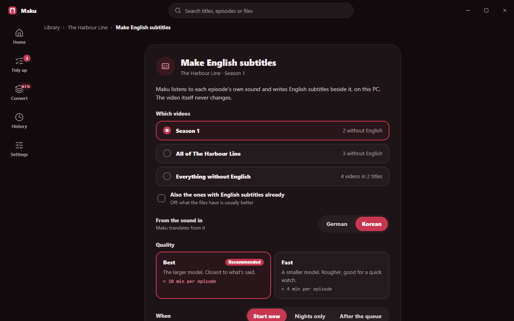
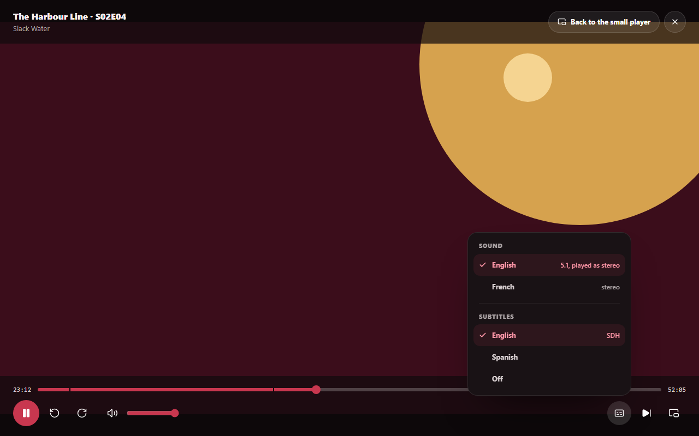
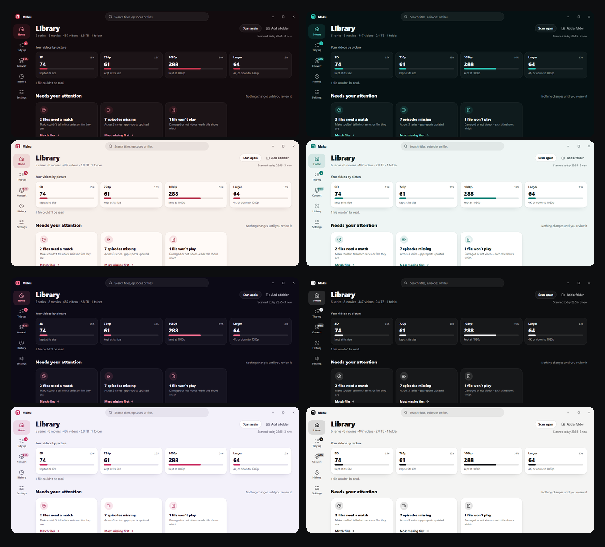

# Maku

**Your series and movies, in order: the companion for your media server.**

A media server streams your library to every screen. Maku gets the library right first. It
recognises every episode and film in your folders, whether you ripped it from a disc, burnt it to
one years ago or bought the download, shows you what's missing, files everything the way popular
media server apps expect, brings every video to one standard (up to 4K, its HDR kept), and makes
English subtitles for the ones with none. Maku (幕, "curtain") runs on your Windows PC beside the
server you already use, and changes nothing until you say yes. It's for the videos you already
have: Maku never finds, downloads or shares video.

   
  
   
  Free and open source · No account · Windows 10 and 11
   
   

## Made for real libraries

Libraries grow untidy: release names full of dots and codecs, seasons spread over folders, films
loose in Downloads, the folders a burnt DVD left behind, SD beside 4K. Media server apps match
files by their names and folders, so an untidy library shows up with gaps, the wrong seasons and
missing artwork. Maku puts the library itself in order and tells you what's missing, so your media
server finds every file where it should be.

## How it works

### 1. Point it at your folders

One series per folder, seasons in folders of their own, films loose or filed, or everything in one
heap: Maku reads every video (length, picture, sound and subtitles) and finds each one on TMDB,
with your own free key. It reads names as releases write them, "The.Harbour.Line.S02E03.1080p" or
"Starfall.2008.EXTENDED.BluRay" alike. Anything it isn't sure of waits for you on "Which title is
this?", with stills and a quick look at the file.

### 2. See what's missing

Every title gets a page: what it's about, its seasons, an episode map, the episodes that aired
that you don't have, and a gap report beside the files. Films TMDB keeps together are one
collection, with the films you don't have yet in their places, and Maku keeps watching for new
ones. Home lists the episodes still to come of the shows you have, by the day they air.

### 3. Tidy up

Maku files everything in the layout media server apps read, `TV\Show (Year)\Season 01\…` and
`Movies\Title (Year)\…`, with subtitles moving alongside. It proposes the changes title by title;
nothing moves until you apply them, and History undoes any of it.

### 4. Bring it all to one standard

Choose 4K or 1080p and Maku encodes HEVC 10-bit on your graphics card. What's 4K stays 4K with its
HDR, nothing is made bigger than it is, every sound track stays as it is (Atmos and all), and
interlaced discs come out smooth. "See it first" shows a frame before and after. The queue can run
at night, waits when a drive is full, and checks every result before it replaces the original.

### 5. English for every episode

An episode with no English, neither in its sound nor in subtitles, gets English subtitles made on
your own PC: Maku listens to its sound and writes it down in English, a season or the whole
library at a time, overnight if you like. They go beside each video under the name media server
apps read, so your server shows them too, and the video itself never changes. Maku marks them as
its own, since names can come out wrong, and History takes them away again.

### 6. Check it, right there

A small player is built in, for a quick look or a whole film: it floats over the page wherever you
drag it, and goes full screen with the sound and subtitles the file has. It remembers where you
stopped, and Home picks up what you're part way through. Overnight, Maku test-plays every video,
so a file damaged since shows before you want it. Your media server does the rest, on the TV, the
phone or wherever you watch.

## Your colours

Four colour schemes, each in light and dark, as Windows is or as you choose: Velvet, wine and
crimson with brass for what's ready; Lagoon, deep teal under a coral sun; Dusk, indigo and coral
pink; and Graphite, black and white.

## Alongside your media server

<table>
  <tr>
    <td nowrap><b>Same folders</b></td>
    <td>Maku works on the folders your media server already watches; its next scan sees the changes.</td>
  </tr>
  <tr>
    <td nowrap><b>Its layout</b></td>
    <td>Show and season folders and file names as media server apps read them: no release tags, resolutions or codecs.</td>
  </tr>
  <tr>
    <td nowrap><b>Its pictures</b></td>
    <td>Poster and background images beside each show and film, if you want them, for servers that use them.</td>
  </tr>
  <tr>
    <td nowrap><b>Hands off</b></td>
    <td>Maku never touches your media server, its database or its settings.</td>
  </tr>
</table>

## Safe by design

<table>
  <tr>
    <td nowrap><b>Asks first</b></td>
    <td>Renames, moves, deletions and conversions are proposed, then applied on your word.</td>
  </tr>
  <tr>
    <td nowrap><b>Undoes</b></td>
    <td>History puts back any tidy-up, and any converted file's original.</td>
  </tr>
  <tr>
    <td nowrap><b>Keeps copies</b></td>
    <td>What's replaced or deleted waits 30 days in quarantine on its own drive.</td>
  </tr>
  <tr>
    <td nowrap><b>Checks</b></td>
    <td>Every video is test-played overnight; what didn't play waits for you, and nothing changes till you say.</td>
  </tr>
  <tr>
    <td nowrap><b>Stays local</b></td>
    <td>No account and no cloud; nightly backups and a one-zip export.</td>
  </tr>
</table>

## The AI inside

Every model runs on your own PC, and no video or sound leaves it. The voice detector ships inside
Maku; Whisper is downloaded the first time you make subtitles, from the source the installer's
first page lists. Maku converts without AI: it never invents detail a picture doesn't have.

<table>
  <tr>
    <td nowrap><b><a href="https://github.com/openai/whisper">Whisper</a></b></td>
    <td>OpenAI's speech model hears an episode's sound and writes it in English: medium for Best, small for Fast, on your graphics card (Fast on the processor when the card hasn't the memory). MIT licence.</td>
  </tr>
  <tr>
    <td nowrap><b><a href="https://huggingface.co/pyannote/segmentation-3.0">pyannote</a></b></td>
    <td>Its speaker segmentation model 3.0 finds where someone speaks, even over music, so Whisper hears just that. MIT licence.</td>
  </tr>
</table>

## Your own videos only

Maku looks after video files that are already on your PC, and plays them only in its own window.
It never searches for, downloads or shares video, nor subtitles or sound tracks (the English
subtitles it makes come from your own video's sound), never streams video over the internet, and
doesn't get around copy protection: it reads the files you made, it doesn't unlock discs. Use it
only with videos you have the right to keep and watch: Maku is not for piracy, in any form.

Maku contains no video, artwork or other media. The titles in these pictures are made up, the
posters are Maku's own placeholders and the video playing is a stand-in. TMDB, where Maku looks
titles up, is its owner's trademark, and Maku isn't affiliated with or endorsed by it, nor by any
media server app. This product uses the TMDB API but is not endorsed or certified by TMDB.

## Download

From the [downloads page](https://frankgrobbelaar.github.io/maku/): Windows 10 or 11, 64-bit,
every version with what changed. Maku updates itself. It isn't code-signed, so SmartScreen warns
the first time: More info › Run anyway. The installer's first page lists everything Maku
downloads, such as ffmpeg on the first run.

### What your PC needs

Maku runs on any 64-bit Windows 10 or 11 PC. What it can convert, and how fast, depends on the
graphics card. Maku tests your PC when it's set up, says what it can and can't do there, and
measures its own times on it.

| For | It works with | Best with |
| --- | --- | --- |
| **Everything but converting** | Windows 10 or 11, 64-bit, and 8 GB of memory: finding and naming series and films, tidying up, the gap analysis and playing | 16 GB of memory |
| **Converting to the standard** | A graphics card or the processor's graphics that encodes HEVC 10-bit: NVIDIA GeForce GTX 10-series or newer, AMD Radeon RX 5000 or newer, or Intel Core 7th generation or newer | NVIDIA GeForce GTX 16-series or newer |
| **English subtitles** | Fast: 2 GB of graphics memory, or the processor, slowly. Best: 4 GB | 6 GB: Best in about 8 minutes an episode |
| **Space** | About 350 MB for Maku and ffmpeg, 2 GB more with both speech models | Room beside your library for a converted file and its original |

Maku installs nothing by hand but a graphics driver, and says when one is too old for what it
asks of the card.

## Licence

Free software under the [MIT licence](LICENSE), with no warranty; what it's built on is listed,
each part with its licence, in `THIRD-PARTY-NOTICES.txt` with every release. Fork it freely; this
repository doesn't take contributions.
