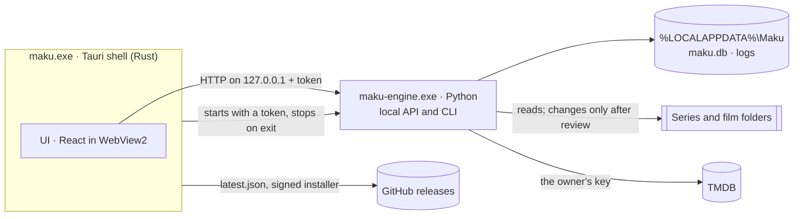

# Architecture

Maku is three programs that work as one: a thin **shell** that owns the window, a **UI** inside it,
and an **engine** that does the real work. Everything runs on this PC; the only network traffic is
looking up series, films and their artwork on TMDB, downloading the tools on Maku's list, and
checking for updates. Maku began as its sibling Kura, and keeps Kura's parts and how they talk.



| Part | Where | Does |
| --- | --- | --- |
| Shell | `app/src-tauri` | The window and its title bar, its look (light or dark, the scheme), one instance at a time, the engine's lifetime, updates |
| UI | `app/src` | Every screen. Reads and changes things only through the engine's API |
| Engine | `engine/src/maku` | Scanning, identifying, planning, converting, reports, export, the database |

The shell stays small on purpose: logic that isn't about the window or the process belongs in the
engine, where it is easy to test.

## Start, run, stop

1. The shell starts `maku serve --watch-stdin` with a fresh random token in `MAKU_TOKEN`
   (in development: `uv run maku …` from `engine/`; installed: the bundled `maku-engine.exe`).
2. The engine listens on `127.0.0.1` on a free port and prints one line:
   `{"event": "ready", "port": 51234}`. Before that, while a long job keeps it starting (moving
   the data to another drive), it prints `{"event": "working"}` every 5 seconds, and the shell
   waits on.
3. The shell sends the UI an `engine-status` event with the address and token.
4. The UI calls the API with `Authorization: Bearer <token>`.
5. On exit the shell closes the engine's stdin and the engine shuts down (the shell ends it
   after 3 seconds if it hasn't). If Maku crashes, Windows closes the pipe anyway, so the engine
   never outlives the window. The engine puts itself in a Windows job that ends every program it
   starts (ffmpeg) when it ends, however it ends.
6. With "Start with Windows" on (Settings > General), Windows starts Maku at sign-in in the tray.
   With "Keep Maku running when you close the window" on (beside it), closing the window keeps
   Maku there, so the queue, the nightly backup and the watching carry on; Quit Maku in the tray's
   menu ends it. Off, closing the window quits Maku. After the ready line the engine may print
   `{"event": "notify", "title": …, "body": …, "link": …}` lines (a finished batch, a queue that
   paused itself), which the shell shows as Windows notifications while the window is away, and
   passes to the window while it's open (the `notice` event), where they show as a note at its
   foot with View leading to `link` (the title's page, History, the queue).

If the engine is silent for a minute before its ready line, exits first, or stops on its own later,
the status becomes `failed` with the engine's last error lines, and the UI says so with "Try again"
and "Copy details". While the window is away (Maku waiting in the tray), a Windows notification
says so once, with the engine's own last sentence when it has one ("Maku's data is in F:\Maku,
which isn't there…"), and the shell tries again by itself after 30 seconds, a minute, 5 minutes,
then every 15 (an engine that ends soon after its ready line, one that couldn't start after all,
counts as failing again, not as a new run). Both sides of this handshake are tested:
`engine/tests/test_cli.py` and `app/src-tauri/src/engine.rs`.

## Contracts

| Between | How | Kept honest by |
| --- | --- | --- |
| Shell and engine | `serve` arguments, `MAKU_TOKEN`, the ready line, stdin | Tests on both sides |
| Shell and UI | Commands `engine_status`, `restart_engine`, `prepare_update`, `install_update`, `look`, `set_look`, `scheme`, `set_scheme` (and the rest in [stack/tauri.md](stack/tauri.md)); events `engine-status`, `notice`; `window.__MAKU_SCHEME__` before the first frame | Types mirrored in `app/src/lib/engine.tsx`, `updates.ts` and `look.ts` |
| UI and engine | JSON over HTTP, camelCase | `engine/openapi.json` snapshot + test; types in `app/src/lib/engine.tsx` |

Change a contract on both sides in the same commit.

## Inside the engine

```
maku/
  cli.py          commands: serve, export, subtitles, openapi, version (and check-directml)
  api/            the FastAPI app; one router module per feature
  core/           library logic as pure functions: no files, network or database
  config.py       where the data folder is
  db.py           connecting to SQLite and migrating it
  migrations.py   the schema, as an append-only list
  library.py      library folders, and finding and reading their videos
  scan.py         the scan: find every video, read each one, identify it, check the library
  identify.py     which series or film, and which episode, each video is, asked of TMDB
  catalog.py      TMDB's shows and films as entries to weigh files against; NoKeyError
  cache.py        TMDB's answers, kept a week so a rescan asks it nothing again
  review.py       the files waiting for the owner on "Which title is this?", and those set aside
  franchises.py   the rest of each collection: its films the library lacks, looked up in turn
  titles.py       the library's titles with their gaps, sorted by release date or otherwise
  reports.py      the gap analysis written next to each series with a folder of its own
  artwork.py      posters and pictures, fetched once from TMDB's image server and kept
  posters.py      choosing a title's poster from TMDB's
  pictures.py     the picture across the top of a video's or an episode's details
  stills.py       frames taken from a video: three for the review screen, one for its details
  watch.py        keeping the library current while Maku is open: watching, refreshing
  probe.py        running ffprobe on one file
  tools.py        downloading what downloads.json lists: ffmpeg, and the speech models when asked
  tidy.py         tidying up: the plan that gives the library clean names, applied and undone
  changes.py      applying and undoing plans (tidy-ups, a converted file's replacement), journaled
  convert.py      converting one file, checked, then in its original's place
  directml.py     DirectML, for Whisper: its card, the lock its users take turns under, and why
                  the PC check's test of it runs in a process of its own
  hardware.py     what this PC has (its cards, processor and memory) and what's kept about it:
                  what checking it found, and its own times, measured as it works
  pc_check.py     checking what this PC can do (its HEVC encoder, the player's, DirectML for
                  Whisper) and timing it, in the background
  queue.py        the queue: files in the owner's order, converted, given English subtitles or
                  another copy's English, one at a time
  speech.py       English subtitles' hearing: the sound read, where someone speaks, Whisper
  subtitles.py    a video's English subtitles made beside it, checked, kept as Maku's, taken away
  merge.py        English from another copy: the two lined up by their sound, the English added
                  to the copy kept, checked, then in its place with both copies set aside
  languages.py    the subtitle files beside videos, and the languages their names say
  preview.py      See it first: one frame before converting and after
  gpu.py          how busy and how warm the graphics card is (nvidia-smi)
  history.py      what Maku did, newest first: tidy-ups, conversions, subtitles made and scans
  search.py       the library searched from the title bar: series, films, episodes and videos
  player.py       playing a video inside the window: tickets, the stream, subtitles copied out
  watched.py      where each video stopped, and what's watched, for Continue watching
  coming.py       each show's next episode still to come, for Coming up, and telling of one out
  checkup.py      the health check: every video test-played overnight, a few at a time
  web.py          asking web services for JSON: timeouts, rate limits, errors in words
  tmdb.py         TMDB: searches, details, episode lists, collections and artwork, with the
                  owner's key
  credentials.py  the TMDB key, encrypted for the Windows user, outside the database
  system.py       ending the programs the engine starts with it, whether another app has a
                  file open, and whether a folder is on another computer
  export.py       the export zip
  data.py         how big each part of the data folder and each drive's quarantine is
  backups.py      the nightly backups of the database, and restoring one as the engine starts
  rescue.py       records damaged past use: what's wrong, and the way back
  quarantine.py   clearing out what has waited in quarantine longer than the owner keeps it,
                  or all of it on one drive when the owner empties it to make room
  care.py         looking after Maku while it's open: tonight's backup, the daily clear-out
  artwork_files.py  poster.jpg and fanart.jpg next to each show, when the owner wants them
  relocate.py     moving the data folder to another drive, as the engine starts
  events.py       what the engine tells the app on its stdout: still starting, notifications
  recovery.py     what Maku settled after it closed unexpectedly, for Home to tell
  leftovers.py    results no conversion is waiting with any more, taken away by a scan
```

The core is the heart and stays pure: it takes plain values (file facts, titles, settings) and
returns plain values (matches, plans, estimates). The code around it reads files, calls services
and writes the database, then hands the core what it needs. That way every rule about the library
is a fast, simple test.

The pipeline, step by step:

| Step | Takes | Gives |
| --- | --- | --- |
| Parse | file names and folders | title, year, season, episode, group, quality |
| Match | parsed names, TMDB's shows and films | which series or film and episode, with a confidence |
| Plan | matches, the standard, the naming style | proposed renames, moves, quarantines, conversions |
| Check | the library, finished conversions | gaps, broken files, verified outputs |
| Estimate | a plan, this PC's measured speeds | GPU time and disk space |

Scanning (`maku/scan.py`) runs on a background thread: it walks each library folder for videos
(`maku/library.py`, by the rules in `maku/core/library.py`) and records each with its size and
time, then reads the new and changed ones with ffprobe (`maku/probe.py`). Everything is saved as it
goes and the scan's stage is in the `scans` table, so a pause, an exit or a crash loses nothing: the
next start carries on. Then each video read is identified (`maku/identify.py`; see
[stack/tmdb.md](stack/tmdb.md)): its name and folders are read (`maku/core/names.py`, see
[stack/anitopy.md](stack/anitopy.md)), files that look like the same series or film are grouped
(a film by its year too, as a remake takes its name again) and looked up together on TMDB with
the owner's key (`maku/catalog.py`: both kinds, the kind the files look like first, each with
every name it goes by), and each show and film found is scored against them
(`maku/core/identify.py`). A sure one is taken, and a show's episode list says where each file
sits (`maku/core/placing.py`): by its season and number, or by its number counted straight
through the show (in a season's folder too, when the folder's files count on from the seasons
before it). A special goes into its show's season 0 by its number there or by its own name
("Special 05 - The Night Train"); one the
list doesn't name is looked up by its own name, and placed only when TMDB keeps it as a film or a
one-off show. Without a TMDB key nothing is looked up: the videos are read and wait, and the
scan's note says Maku needs the key (`NoKeyError`). The films TMDB keeps in one collection make a
franchise (`maku/core/franchise.py`; the app says "collection"), named as TMDB names the
collection: Home shows a collection of several films as one card with a page of its own, and a
series always stands alone, as TMDB ties no show to another. The rest of each collection, its
films whether the library has them or not, is looked up in the background (`maku/franchises.py`,
at most 200 entries a franchise) and kept in `entries`, so a collection's page can show what it
lacks ("Missing films"): what no video is matched to, and no show the library has keeps among its
specials. Only the links of entries the library holds tie its titles together, so what's looked
up beyond them never joins two cards on Home. A file Maku isn't sure about waits for the owner on
"Which title is this?", whose choice is pinned (an episode Maku can't place asks for its number),
or who sets it aside as not a series or film, pinned too; the files set aside are listed, and one
taken back waits again, looked up afresh at the next scan (`Identifier.unignore`). Offline,
identification waits for the next scan and the scan says so. A title's match can be changed for
all its files at once (`Identifier.rematch`), chosen for its first episode: files of that kind
take the owner's choice, the others keep theirs (a series' specials stay specials), and any that
doesn't fit the new show or film waits for the owner. Last, the scan checks the library: each
series with a folder of its own gets its `Maku - Gap analysis.md` (`maku/reports.py`), rewritten
only when its news changes. The missing episodes are the ones TMDB lists as aired that no file
holds (`maku/core/gaps.py`); specials are listed apart and never counted as missing.

While Maku is open, `maku/watch.py` keeps the library current: a scan at start catches up on what
changed while Maku was closed; the library folders are watched (`watchdog`), so a new, removed or
renamed video wakes the watcher, which starts a scan once its folder has been quiet five
seconds, looking every second meanwhile; episode lists are asked for again on schedule,
hourly for shows still airing and weekly for finished ones, and films weekly; and each
look-around, every 15 seconds, asks TMDB about six more entries of the library's collections,
unless a change waits for its scan: the ones not asked about yet first, then each again weekly,
or daily while it's still to come. Each scan keeps what it found new
(`found_at`) and gone (`gone_at`, both its start), counted in the `scans` table for History.
The UI asks how scans stand every three seconds from the window's shell (`useScan`), and once one
has ended, however quickly (most take under a second), every screen asks again for what it shows.
A folder on an unplugged drive is skipped and its files stay as they were,
and so do the files in a folder the walk couldn't open; only a file whose folder is there without
it is marked gone. Links and junctions aren't followed. Files that couldn't be read are read again
by the next scan. If ffprobe itself doesn't work, the scan stops without marking any file and
ffmpeg is offered for download again. Scans only look; nothing in the folders changes.

Tidying up (`maku/tidy.py`) proposes where every identified video goes: clean names, in the
layout media server apps read, under its own library folder (`maku/core/plan.py` and
`maku/core/naming.py`): `TV\The Harbour Line (2019)\Season 01\The Harbour Line (2019) - S01E01 -
Pilot.mkv` and `Movies\Starfall (2008)\Starfall (2008).mkv`. Each title's changes go together,
with copies of one episode compared and all but the best set aside in a "Maku quarantine" folder
on the same drive. Copies are files of one title's same episode (a file holding two episodes isn't
a copy of one) or of one film; a film in parts (CD1, CD2) is filed as its parts (`- pt1`, `- pt2`,
as media servers stack them). A video stays where it is, with the reason, when its new name would
be too long for Windows (its subtitles' included) or its new folder is one scans skip (a link, or
a name starting with a dot). A folder on the way that's there already keeps its own spelling
("the harbour line (2019)"), so the records name files exactly as the disk does. The owner keeps
the titles they want, and may keep the other copy instead.

A plan is applied only after review, exactly as reviewed: the app sends back each change it
showed (source, kind and target), and if Maku proposes any of them differently now (a scan or a
new match changed it), nothing moves and the owner looks again. `maku/changes.py` writes each
change to the database before and after its file moves, so it can be undone (newest first) and
so the engine, when it starts, can settle any move a crash interrupted. A plan counts as applied
from its first move, so History has it even after a crash, and the moves Maku hadn't reached
are closed at the next start (tidying up proposes them again). A change and its video's record
are saved together. Nothing is overwritten: a name another file has gets "(2)" in the plan, and
the review shows the two side by side ("Compare the two") or leaves that video out this time
("Skip"); a video left out keeps its subtitles with it, whatever was sent, and a name taken
after the review fails that change while the rest go ahead. A move to another drive copies,
checks the copy, and
only then removes the original. Subtitle files named after a video (`Episode 1.en.srt`) move and
rename with it (and stay with one that couldn't move: another app had it open, say), and folders
inside a library folder that the moves leave truly empty are removed
(undo makes them again as it moves the files back). A video's record moves with it, so it keeps
what it was identified as (a quarantined one counts as gone until it's put back); a gap analysis
left in a folder that no longer holds a video goes with the folder, and the reports are written
again where the shows are. Nothing moves while a scan runs, and no scan starts while files move
(`Scanner.hold`); what Windows tells of Maku's own moves starts no scan, since the records
follow them already. History lists every tidy-up,
which can be undone from there, and undone again for any file that couldn't go back the first
time (the plan counts as undone only once nothing is left). It comes a week's worth of days at a
time (`history.page`, the local day each thing happened on; an undo shows on its own day), and
the owner can clear it (`history.clear`): all of it or what's older than a day, week or month by
hand, or what's older than 7, 30 or 90 days each day with the quarantine's clear-out (Settings ›
Your data; kept for good at first). Clearing forgets records only: what still has a copy in
quarantine stays, so it can be put back and the clear-out finds it, as does a change under way
and the latest scan; no file changes.

Deleting (`tidy.delete`, from a title's page: the whole title, a season or one video; and from
"Which title is this?": a file waiting for a match, or one set aside) is a plan of the same kind:
each video and the subtitles named after it go to the quarantine on their own
drive (subtitles another copy of the video shares stay with it), folders left empty go, a video
waiting to be converted leaves the queue once it's gone (one converting can't be deleted), the
page says what stayed and why, and History, or the page right after, puts them back until the
quarantine is cleared out. Maku never deletes a file outright. Whatever its records say (a damaged
database, or one an imported export held), Maku deletes only a file in a day's folder of a
quarantine (`core.plan.in_quarantine`), its own unfinished results (`.maku-converting`,
`.maku-partial`) and its own `poster.jpg` and `fanart.jpg`; and, finishing a move to another
drive that a stop cut short, the original once the same file is in place (`changes._settle`).

Converting (`maku/convert.py`) brings one file to the standard, HEVC 10-bit in an MKV and never
bigger than it is, with one ffmpeg command its recipe makes (`maku/core/convert.py`): the picture
copied (a remux) or made anew on the graphics card's encoder, deinterlaced or brought down to the
standard where it needs, its HDR kept, every sound track as it was (see
[stack/encoding.md](stack/encoding.md)). The result is made beside the original, checked (length,
streams, its picture and HDR, Maku's tag, a test play at three points), and only then takes the
original's place, journaled like a tidy-up, the original going to quarantine; no scan runs
meanwhile. When the owner chose to delete originals, that one is cleared out of quarantine right
after (`quarantine.clear_original`), and the queue reckons each drive's room so: a result wants its
room only while it's made, and keeps what it adds over its original. What a file needs is decided
against the standard as it is now, so a changed standard offers again what Maku converted to the old
one. The queue (`maku/queue.py`) holds the files waiting, in the owner's order, and its worker
converts them one at a time while Maku is open; on the nights-only schedule it starts files only
between 23:00 and 07:00, or till 03:00 on a night the owner says to stop then (the queue page's
overnight note, `Queue.stop_early`), so Windows' sleep comes back sooner. Pausing or skipping stops
ffmpeg at once and leaves the original as it was (a paused file starts over); a result made already
is still checked and put in place when the queue pauses, and thrown away when it's skipped. A file
whose result would take a name that's taken fails before anything is made, and Windows doesn't sleep
while a file converts. A file saved over while it converted is left as it is now, and its result
goes. When another app has the original open as its result is ready (a player playing it:
`system.in_use` asks Windows for the right to move it), the checked result waits beside it and the
next file goes; a second thread of the queue puts it in place once the app lets go, trying every 5
minutes, or at once on "Try now", though another file is converting (`Queue.try_waiting`,
`convert.put_in`). Skipping it throws the result away (one a scan later finds that no job wants, its
drive away when it was skipped, say, goes then: `maku/leftovers.py`; a result is named after its
whole original, `Ep01.avi.maku-converting`, so an `Ep01.mp4` beside it has its own). After a crash,
a file that was converting waits in line again, and one whose result was taking its original's place
is finished, or its original put back. A clean stop leaves none of these, so finding any (or a
tidy-up's moves in flight) is how Maku knows it closed unexpectedly: `maku/recovery.py` keeps what
was settled, and Home says so in a sentence, until the owner looks (History has each file), for a
day. A stop the app asked for isn't told of, even one the app cut short (the engine notes
`stopping.txt` as it starts stopping), and nor is a start that restored a backup. A file being
converted (its result waiting beside it too), and any copy of it, stays out of tidy-ups and deletes.
History lists each conversion with what it made, and puts the original back on asking, a file's
latest change first: a file converted again since, or given another copy's English, has that put
back before (`convert.replaced_since`), and only the file a job made is ever taken out of the way.
Before queueing, the Convert screen shows one frame of a file before and after (`maku/preview.py`),
made the way the conversion would make it, and kept as PNG in the cache.

English from another copy (`maku/merge.py`, its rules in `maku/core/merge.py` and
`maku/core/align.py`): when Tidy up keeps one of two copies of an episode and the other has English
sound or subtitles in it that the kept one hasn't (in it or beside it), the owner can have that
English added to the kept copy instead of it going to quarantine with the other. The other copy then
stays where it is, out of tidy-ups, conversions and subtitles, and a job of kind 'merge' goes next
in the queue (it's quick, and a conversion of the file after it keeps the English). Maku reads a
sound track both copies have in the same language and finds how far one runs ahead of the other
from how their loudness rises and falls, which two mixes of the same cut share, checking the same
offset holds at the start, the middle and the end; copies that aren't the same cut (a scene cut, another
speed) stay as they are, and Tidy up says why the next time it offers them. Both copies must be as
Maku read them. ffmpeg copies the kept copy whole with the other's English beside it, shifted onto
its picture and ending with it (see [stack/ffmpeg.md](stack/ffmpeg.md)); English that can't come as
Tidy up offered it (subtitles drawn as pictures, from a copy that runs later) leaves both copies as
they are. The result is checked (never shorter than the kept copy, its tracks, a test play) and
takes the kept copy's place as a conversion's does, waiting beside it while another app has either
copy open, and no other job makes a result beside a file whose result waits there (they'd share its
name). The kept copy as it was and the other, with the subtitles named after it, go to quarantine in
the same journaled plan, the other first (the result may take its name), which History puts back
together; what of the other copy couldn't come back is said, and asked again, put back then, or on
its own once the kept copy as it was is gone from quarantine. That kept copy stays in quarantine
whatever the owner chose for converted files' originals: it wasn't converted.

A drive without room for a result (its estimated size with a margin, `convert.room_for`, free
space measured at the file's own folder, which may be another volume mounted there) pauses the
queue, which says what the files waiting there want and what's free (`queue.Room`); the Convert
screen works out the same before queueing a choice. A file that turns out, as converting starts,
to want more than the queue reckoned (a picture found interlaced is made anew) is remembered as
wanting that much. The owner can empty that drive's quarantine first (`quarantine.empty`:
everything set aside there goes for good, so the app asks once more), or convert what fits
(`Queue.convert_what_fits`): the files there that fit convert in turn and the rest wait for room
while the others go, starting by themselves once there is, till none waits there (then a full
drive pauses the queue again, to ask).

A video plays inside Maku's window (`maku/player.py`, its commands in `maku/core/player.py`,
`api/player.py`): `POST /player` gives a ticket for a library file with what it offers to play
(sound, subtitles, chapters), and the window's `<video>` plays `/stream/<ticket>?at=…`. That one
address takes no token, since a `<video>` can't send one: the ticket, a long random name the
window alone is told, is its key, and only the latest four work. Each stream is ffmpeg making
fragmented MP4 on the fly from `at` seconds (H.264, AAC stereo, the subtitles drawn into the
picture), and a new stream of the same video (a seek, another sound track) stops the one before,
as do closing the player and the window letting go. Text subtitles in the file are copied out to
`cache/player/` first (that reads the whole file), with the file's fonts under names of Maku's,
so the video plays at once and its subtitles join when they're ready; subtitles that are pictures
are laid over straight from the file, and a subtitle file beside the video is used as it is. A
stream that ends early says why (the drive went, the file went, the file is damaged there), and
the copies of the last six videos' subtitles stay. See [stack/ffmpeg.md](stack/ffmpeg.md).

A title's About panel (`maku/core/about.py`, `titles.about`, in `GET /titles/{id}` and alone
at `GET /titles/{id}/about`) is what TMDB says of it: its synopsis, genres, network or first
production company, where it stands (finished, airing, coming, cancelled, on a break), when it
aired and how long an episode lasts. What's kept on its row, as current as the episode list,
comes first; what's kept of its entry in `entries` fills in what that doesn't say, and an
episode's length, when neither says, is the one most of its episodes last. A film a collection
lacks shows its entry's alone, in a card on the collection's page.

A video's details (`maku/api/files.py`, `GET /files/{id}`) are its row and what ffprobe read
of it: the picture, each sound and subtitle track, the subtitle files beside it, chapters, and
what converting it to the library's standard does, planned as Convert would. An episode's
(`GET /titles/{id}/episodes/{season}/{number}`) are TMDB's, with its video when the library has
it, so the missing ones open too. TMDB's synopsis of an episode is kept on its row as the episode
list is refreshed, and so is the path of its picture (`still`). Each has a picture for the top of
its details (`maku/pictures.py`): `GET /files/{id}/picture` is TMDB's from its episode, else a
frame from the file 15% of the way in (`maku/stills.py`, a card's width, its pixels made
square), else its show's wide picture; `GET /titles/{id}/episodes/{season}/{number}/picture` is
TMDB's from the episode, else its show's. Each is fetched or taken once and kept (`artwork/`,
`cache/stills/`), and answered with `Maku-Picture: episode` or `show` (CORS lets the window read
it): the window blurs a picture from an episode not yet watched till the owner asks, as it can
give the story away.

What the owner has watched (`maku/watched.py`, the rules in `maku/core/watched.py`) is a row per
video in `watched`: where it stopped, when it last played, and when it was seen to its last tenth
or marked watched. The player says where it is every ten seconds while it plays and as it stops
(`PUT /files/{id}/position`), once it has played for ten seconds; a video's menu marks it watched
or not (`POST /files/watched`). Play picks a video up where it stopped, unless that was in its
first 30 seconds or its last tenth. Home's "Continue watching" (`GET /continue`) takes each title's
latest video that counts (stopped part way, or watched): stopped part way, it's picked up there;
watched, the next one not watched yet is up next, in the order a title's page plays them. A
title can be left out of it (`DELETE /continue/{id}`) till one of its videos plays again.

Home's "Coming up" (`maku/coming.py`, `GET /coming`) is each title's next episode airing today
or later that no video of the library's covers, from the episode lists Maku keeps (asked for
hourly while a show airs). On the day one airs, the watcher tells the owner as it looks around
(`Watcher.tell_aired`, one notification for the day's), and `aired_told` keeps each told once.

The health check (`maku/checkup.py`, run by `maku/care.py`) test-plays each video at night while
the queue has no job: a few seconds at three points, its picture decoded as a player would from
there (`-progress` counts the pictures that came; an original can say a little as it starts at a
point and still play), for four minutes at a time, a few seconds apart, while there are videos
due: never checked first, then those checked over a month ago, in the folders that are there (a
drive that isn't connected waits). A file that changes is due again, and one Maku converts counts
as checked as it's made. A video that doesn't play keeps what ffmpeg said
(`files.health_problem`) and is listed for the owner (`GET /checkup`), one notification telling of
the night's once its check is done; it becomes broken only when the owner marks it so (`POST
/files/{id}/broken`). `POST /files/{id}/check` plays one again now, and `POST /files/{id}/plays`
takes it off the list till next month's check.

Home's "At a glance" (`GET /library/glance`) adds up how long the library's videos play, how much
of that was watched, what each video's latest conversion still in place did to its size (from
the queue's jobs: one put back from History doesn't count), and the titles taking the most room.

A title's poster can be chosen (`maku/posters.py`, `GET /titles/{id}/posters`, `PUT
/titles/{id}/poster`) from TMDB's (`/tv/{id}/images` and `/movie/{id}/images`, in English or
without words, the best rated first, kept a day), the one it has first. The choice is kept in
`titles.poster_choice`, apart from the poster the episode list brings, which a refresh updates;
every reader takes `COALESCE(poster_choice, poster)`. The poster Maku wrote next to the show, as
it wrote it, makes way for the new one.

The title bar's search (`maku/search.py`, `GET /search?q=`) finds the library's series and films
by any name TMDB says they go by, their episodes by code or name (the ones the library lacks too),
and its videos by their files' names. Every word typed must be there, however a name is written:
`maku/core/search.py` lowers the case, takes accents off and makes full-width letters plain, and
ranks the name itself first, then one that starts with what was typed. An episode or a video is
found only by something of its own, so a search for a show finds the show, not all its episodes.
It reads the whole library each time, a few tens of milliseconds on a big one; the app asks once
the owner stops typing. History searches the same way (`GET /history?q=`): the tidy-ups,
conversions and batches of subtitles whose title, or one change's label or file, has every word.

## Data

- **The data folder**, `%LOCALAPPDATA%\Maku`: `maku.db` (everything Maku knows), `logs/`
  (`engine.log`, kept 30 days), `tools/` (ffmpeg, and Whisper's models once asked for),
  `credentials.json` (the TMDB key, encrypted by Windows for this user and never exported),
  `cache/` (TMDB's answers, kept a week, frames taken from videos and the player's copies of
  subtitles; safe to delete), `artwork/` (posters and pictures from TMDB), `backups/` (the last 7
  nights, each checked as it's made, and
  apart from them the last 7 made by hand, before a restore and from an export; none is ever
  written over). `maku/care.py` makes tonight's backup from 03:00 (or the first chance after) and
  clears out of the quarantine, once a day, what has waited longer than the owner keeps it. A
  backup chosen in Settings is restored as the engine starts again, before anything opens the
  database, once it checks out; what Maku knew till then is backed up first, and kept even when
  it doesn't check out.
  Development uses `engine/.dev-data`, so it never touches the real folder.
- **Moving it** to another drive (Settings > Your data, `maku/relocate.py`): the owner picks a
  folder (an empty or new one on a drive of this PC's own, not a network share, where SQLite's
  write-ahead log isn't safe; outside the data folder, with room); the app starts the engine
  again, and as it starts, before it logs or opens anything, the engine copies the data there,
  checks the copy (sizes and the database), and only then removes the old one. The home folder
  keeps a note, `location.txt` (UTF-16, so the uninstaller reads any path's letters), naming
  where the data went: Maku, `maku export` and the
  uninstaller follow it, and an engine whose moved data isn't there (an unplugged drive) says so
  instead of starting empty. A move that fails leaves everything where it was, and Settings says
  why. While the data moves, the home keeps `moving.json` (where from, where to), so a move cut
  short (a power cut, the app ended) is settled at the next start: finished when the data had
  switched to its new place, or else the part-made copy goes and Settings says so.
- **The database** is SQLite, upgraded in place by migrations (see
  [stack/sqlite.md](stack/sqlite.md)); Maku's first is Kura's schema as it stood at Kura 1.3.0.
  A database written by a newer Maku is refused, not damaged. Records damaged past use (a disk
  fault, a power cut mid-write: `maku/rescue.py`) are found as the engine starts, before anything
  else opens them; the engine then answers only `/records` and `/health`, tells the app (a
  notification, while Maku waits in the tray), and the app's window shows the way back in place
  of every page: the newest backup that opens, restored over them, or, with none, new records as
  on Maku's first day (when the disk couldn't read them, Try again comes first). Either way the
  damaged file is set aside as it is, never deleted (`maku (damaged 2026-10-12 0930).db`, with its
  `-wal`, beside where it was), and the app starts the engine again.
- **With the videos**: `Maku - Gap analysis.md` per series (the owner can turn these off in
  Settings, which takes them out of the folders), a tag inside each converted MKV, the English
  subtitles Maku made when asked (`.en.srt`), and, when the owner turns them on, `poster.jpg` and
  `fanart.jpg` in each show's and film's own folder for media servers (`maku/artwork_files.py`,
  written by Maku's care from TMDB's larger pictures; never over a file that's there, and only
  Maku's own, unchanged, taken away again, or made way for once the videos are matched to another
  title; a show whose drive isn't connected waits, and a picture the server refuses is asked for
  again only a day later). These survive a reinstall, and Maku can rebuild its library from the
  tags.
- **Export**: one zip, readable without Maku, written to a folder the owner picks in Settings (or
  with `maku export`). It grows with the schema. Settings imports one too, from this PC or
  another: the database it holds is restored like a backup as the engine starts again (kept
  beside the backups as one "from an export"), and what Maku knew till then is backed up first.
  An export from a newer Maku waits for an update.
- **Quarantine**: `Maku quarantine\<day>\` on each drive the library is on, holding copies set
  aside and converted files' originals; Settings shows its size and how long it's kept.

## Safety on a shared PC

- The engine listens only on `127.0.0.1`, on a port chosen at random.
- Every request needs the launch's token; anything else gets 401. The one exception is a
  video's stream (`/stream/<ticket>`), which the window's `<video>` asks for without it: its
  ticket, given only to the window and only for a library file it opened, is the key.
- Only the app's own pages may call it (CORS), and only when addressed to this PC (Host check).
- The window's content security policy allows the app itself, Tauri's IPC and the local engine
  (its pictures, and its video streams).
- The window may call only the core APIs, its title bar buttons and Maku's own commands
  (`app/src-tauri/capabilities/default.json`).
- An update runs only if its signature matches the public key built into Maku.

## On an installed PC

| What | Where |
| --- | --- |
| Program | `%LOCALAPPDATA%\Programs\Maku` (`maku.exe`, `engine\`, `uninstall.exe`) |
| Data | `%LOCALAPPDATA%\Maku` |
| WebView2 cache | `%LOCALAPPDATA%\io.github.frankgrobbelaar.maku` |
| Uninstaller's export | `Documents\Maku export <date>.zip` |
